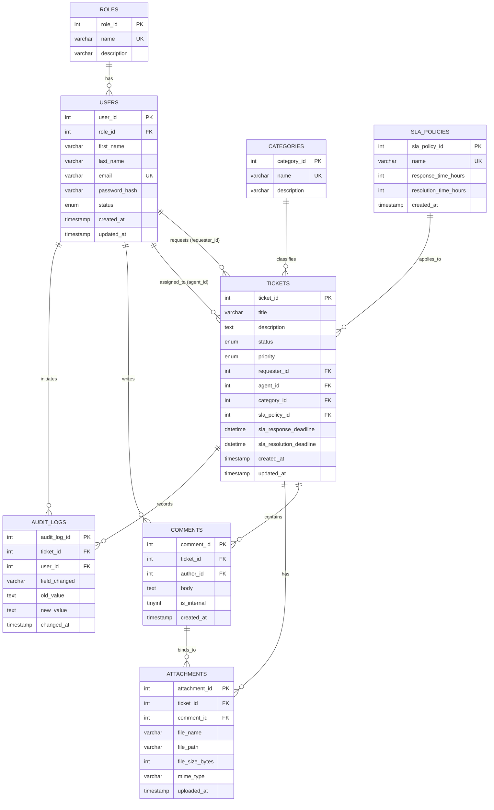

# MySQL Database Schema Specification
## Help Desk Ticketing and Reporting System

This document details the complete MySQL database design. It contains the physical schema definitions, relationships, indexes, standard DDL (Data Definition Language) queries, and sample DML (Data Manipulation Language) queries for testing.

---

## 1. Physical Schema ERD



---

## 2. Table Structures & Attributes

### 2.1 Table: `roles`
Stores role profiles for authorization.

| Column | Data Type | Key / Constraint | Description |
| :--- | :--- | :--- | :--- |
| `role_id` | INT | PK, AUTO_INCREMENT | Unique identifier for the role. |
| `name` | VARCHAR(50) | UNIQUE, NOT NULL | Role name (e.g., `requester`, `agent`, `manager`, `admin`). |
| `description` | VARCHAR(255) | NULL | Short summary of role scope. |

### 2.2 Table: `users`
Stores support staff and customer account details.

| Column | Data Type | Key / Constraint | Description |
| :--- | :--- | :--- | :--- |
| `user_id` | INT | PK, AUTO_INCREMENT | Unique user identifier. |
| `role_id` | INT | FK -> `roles.role_id`, NOT NULL | Link to role authorization rules. |
| `first_name` | VARCHAR(50) | NOT NULL | User's first name. |
| `last_name` | VARCHAR(50) | NOT NULL | User's last name. |
| `email` | VARCHAR(100) | UNIQUE, NOT NULL | Primary communication and login email. |
| `password_hash` | VARCHAR(255) | NOT NULL | BCrypt hash of login password. |
| `status` | ENUM('active','inactive') | DEFAULT 'active' | Active/inactive state. |
| `created_at` | TIMESTAMP | DEFAULT CURRENT_TIMESTAMP | Date the profile was created. |
| `updated_at` | TIMESTAMP | DEFAULT CURRENT_TIMESTAMP ON UPDATE CURRENT_TIMESTAMP | Audit field tracking last update. |

### 2.3 Table: `categories`
Stores functional areas for classifying tickets.

| Column | Data Type | Key / Constraint | Description |
| :--- | :--- | :--- | :--- |
| `category_id` | INT | PK, AUTO_INCREMENT | Unique category identifier. |
| `name` | VARCHAR(100) | UNIQUE, NOT NULL | Name (e.g. `Hardware`, `Software`, `Billing`). |
| `description` | VARCHAR(255) | NULL | Details about issues within this category. |

### 2.4 Table: `sla_policies`
Houses rules governing expected response and resolution rates.

| Column | Data Type | Key / Constraint | Description |
| :--- | :--- | :--- | :--- |
| `sla_policy_id` | INT | PK, AUTO_INCREMENT | Unique policy identifier. |
| `name` | VARCHAR(100) | UNIQUE, NOT NULL | Policy title (e.g. `Urgent SLA`, `Low Priority SLA`). |
| `response_time_hours`| INT | NOT NULL | Maximum hours allowed for first agent reply. |
| `resolution_time_hours`| INT | NOT NULL | Maximum hours allowed to resolve the ticket. |
| `created_at` | TIMESTAMP | DEFAULT CURRENT_TIMESTAMP | Date SLA policy was configured. |

### 2.5 Table: `tickets`
The central transaction table holding core issue tickets.

| Column | Data Type | Key / Constraint | Description |
| :--- | :--- | :--- | :--- |
| `ticket_id` | INT | PK, AUTO_INCREMENT | Unique incident reference ID. |
| `title` | VARCHAR(150) | NOT NULL | Ticket header summary. |
| `description` | TEXT | NOT NULL | Detailed problem description. |
| `status` | ENUM('new', 'open', 'pending', 'resolved', 'closed') | DEFAULT 'new' | Lifecycle status values. |
| `priority` | ENUM('low', 'medium', 'high', 'urgent') | DEFAULT 'medium' | Relative urgency of response. |
| `requester_id` | INT | FK -> `users.user_id`, NOT NULL | The user raising the concern. |
| `agent_id` | INT | FK -> `users.user_id`, NULL | The support agent solving the ticket. |
| `category_id` | INT | FK -> `categories.category_id`, NOT NULL | Functional category bucket. |
| `sla_policy_id` | INT | FK -> `sla_policies.sla_policy_id`, NOT NULL | Applied SLA rules metadata. |
| `sla_response_deadline`| DATETIME | NULL | Timestamp threshold for first reply. |
| `sla_resolution_deadline`| DATETIME | NULL | Timestamp threshold for final resolution. |
| `created_at` | TIMESTAMP | DEFAULT CURRENT_TIMESTAMP | Creation time of ticket. |
| `updated_at` | TIMESTAMP | DEFAULT CURRENT_TIMESTAMP ON UPDATE CURRENT_TIMESTAMP | Audit field tracking last ticket edit. |

### 2.6 Table: `comments`
Stores public customer-agent dialogs as well as private notes.

| Column | Data Type | Key / Constraint | Description |
| :--- | :--- | :--- | :--- |
| `comment_id` | INT | PK, AUTO_INCREMENT | Unique log ID. |
| `ticket_id` | INT | FK -> `tickets.ticket_id`, NOT NULL | Ticket this comment is filed under. |
| `author_id` | INT | FK -> `users.user_id`, NOT NULL | User writing the comment. |
| `body` | TEXT | NOT NULL | Comment message contents. |
| `is_internal` | TINYINT(1) | DEFAULT 0 | 0 = Public, 1 = Private note visible only to agents. |
| `created_at` | TIMESTAMP | DEFAULT CURRENT_TIMESTAMP | Posting timestamp. |

### 2.7 Table: `attachments`
Stores references to files uploaded relative to ticket creation or follow-up comments.

| Column | Data Type | Key / Constraint | Description |
| :--- | :--- | :--- | :--- |
| `attachment_id` | INT | PK, AUTO_INCREMENT | Unique attachment reference ID. |
| `ticket_id` | INT | FK -> `tickets.ticket_id`, NOT NULL | Associated ticket. |
| `comment_id` | INT | FK -> `comments.comment_id`, NULL | Optional parent comment referencing the upload. |
| `file_name` | VARCHAR(255) | NOT NULL | Original disk file name. |
| `file_path` | VARCHAR(512) | NOT NULL | Path reference inside object storage buckets. |
| `file_size_bytes` | INT | NOT NULL | Storage footprint size in bytes. |
| `mime_type` | VARCHAR(100) | NOT NULL | System safety MIME descriptor (e.g. `image/png`). |
| `uploaded_at` | TIMESTAMP | DEFAULT CURRENT_TIMESTAMP | Upload timestamp. |

### 2.8 Table: `audit_logs`
Automated system tracking for database change history.

| Column | Data Type | Key / Constraint | Description |
| :--- | :--- | :--- | :--- |
| `audit_log_id` | INT | PK, AUTO_INCREMENT | Unique log entry ID. |
| `ticket_id` | INT | FK -> `tickets.ticket_id`, NOT NULL | Associated ticket link. |
| `user_id` | INT | FK -> `users.user_id`, NULL | Operator triggering change (null = system system). |
| `field_changed` | VARCHAR(50) | NOT NULL | The structural field changed (e.g. `status`). |
| `old_value` | TEXT | NULL | Original database value. |
| `new_value` | TEXT | NULL | Updated database value. |
| `changed_at` | TIMESTAMP | DEFAULT CURRENT_TIMESTAMP | Audit date timestamp. |

---

## 3. SQL DDL Scripts

Below is the clean SQL layout optimized for execution in **MySQL 8.0+**. Foreign keys map with explicit database lifecycle controls (`ON UPDATE CASCADE`).

```sql
-- Disable foreign key checks temporarily to allow clean drops in dev environments
SET FOREIGN_KEY_CHECKS = 0;
DROP TABLE IF EXISTS audit_logs;
DROP TABLE IF EXISTS attachments;
DROP TABLE IF EXISTS comments;
DROP TABLE IF EXISTS tickets;
DROP TABLE IF EXISTS sla_policies;
DROP TABLE IF EXISTS categories;
DROP TABLE IF EXISTS users;
DROP TABLE IF EXISTS roles;
SET FOREIGN_KEY_CHECKS = 1;

-- =========================================================================
-- 1. Table: roles
-- =========================================================================
CREATE TABLE roles (
    role_id INT AUTO_INCREMENT,
    name VARCHAR(50) NOT NULL,
    description VARCHAR(255) DEFAULT NULL,
    CONSTRAINT pk_roles PRIMARY KEY (role_id),
    CONSTRAINT uq_role_name UNIQUE (name)
) ENGINE=InnoDB DEFAULT CHARSET=utf8mb4 COLLATE=utf8mb4_unicode_ci;

-- =========================================================================
-- 2. Table: users
-- =========================================================================
CREATE TABLE users (
    user_id INT AUTO_INCREMENT,
    role_id INT NOT NULL,
    first_name VARCHAR(50) NOT NULL,
    last_name VARCHAR(50) NOT NULL,
    email VARCHAR(100) NOT NULL,
    password_hash VARCHAR(255) NOT NULL,
    status ENUM('active', 'inactive') DEFAULT 'active',
    created_at TIMESTAMP DEFAULT CURRENT_TIMESTAMP,
    updated_at TIMESTAMP DEFAULT CURRENT_TIMESTAMP ON UPDATE CURRENT_TIMESTAMP,
    CONSTRAINT pk_users PRIMARY KEY (user_id),
    CONSTRAINT uq_user_email UNIQUE (email),
    CONSTRAINT fk_users_role_id FOREIGN KEY (role_id) 
        REFERENCES roles (role_id) 
        ON DELETE RESTRICT 
        ON UPDATE CASCADE
) ENGINE=InnoDB DEFAULT CHARSET=utf8mb4 COLLATE=utf8mb4_unicode_ci;

-- Add index on role lookup for performance
CREATE INDEX idx_users_role_id ON users (role_id);

-- =========================================================================
-- 3. Table: categories
-- =========================================================================
CREATE TABLE categories (
    category_id INT AUTO_INCREMENT,
    name VARCHAR(100) NOT NULL,
    description VARCHAR(255) DEFAULT NULL,
    CONSTRAINT pk_categories PRIMARY KEY (category_id),
    CONSTRAINT uq_category_name UNIQUE (name)
) ENGINE=InnoDB DEFAULT CHARSET=utf8mb4 COLLATE=utf8mb4_unicode_ci;

-- =========================================================================
-- 4. Table: sla_policies
-- =========================================================================
CREATE TABLE sla_policies (
    sla_policy_id INT AUTO_INCREMENT,
    name VARCHAR(100) NOT NULL,
    response_time_hours INT NOT NULL,
    resolution_time_hours INT NOT NULL,
    created_at TIMESTAMP DEFAULT CURRENT_TIMESTAMP,
    CONSTRAINT pk_sla_policies PRIMARY KEY (sla_policy_id),
    CONSTRAINT uq_sla_policy_name UNIQUE (name)
) ENGINE=InnoDB DEFAULT CHARSET=utf8mb4 COLLATE=utf8mb4_unicode_ci;

-- =========================================================================
-- 5. Table: tickets
-- =========================================================================
CREATE TABLE tickets (
    ticket_id INT AUTO_INCREMENT,
    title VARCHAR(150) NOT NULL,
    description TEXT NOT NULL,
    status ENUM('new', 'open', 'pending', 'resolved', 'closed') DEFAULT 'new',
    priority ENUM('low', 'medium', 'high', 'urgent') DEFAULT 'medium',
    requester_id INT NOT NULL,
    agent_id INT DEFAULT NULL,
    category_id INT NOT NULL,
    sla_policy_id INT NOT NULL,
    sla_response_deadline DATETIME DEFAULT NULL,
    sla_resolution_deadline DATETIME DEFAULT NULL,
    created_at TIMESTAMP DEFAULT CURRENT_TIMESTAMP,
    updated_at TIMESTAMP DEFAULT CURRENT_TIMESTAMP ON UPDATE CURRENT_TIMESTAMP,
    CONSTRAINT pk_tickets PRIMARY KEY (ticket_id),
    CONSTRAINT fk_tickets_requester_id FOREIGN KEY (requester_id) 
        REFERENCES users (user_id) 
        ON DELETE RESTRICT 
        ON UPDATE CASCADE,
    CONSTRAINT fk_tickets_agent_id FOREIGN KEY (agent_id) 
        REFERENCES users (user_id) 
        ON DELETE SET NULL 
        ON UPDATE CASCADE,
    CONSTRAINT fk_tickets_category_id FOREIGN KEY (category_id) 
        REFERENCES categories (category_id) 
        ON DELETE RESTRICT 
        ON UPDATE CASCADE,
    CONSTRAINT fk_tickets_sla_policy_id FOREIGN KEY (sla_policy_id) 
        REFERENCES sla_policies (sla_policy_id) 
        ON DELETE RESTRICT 
        ON UPDATE CASCADE
) ENGINE=InnoDB DEFAULT CHARSET=utf8mb4 COLLATE=utf8mb4_unicode_ci;

-- Database Performance Indexes for query tuning and sorting dashboard lookups
CREATE INDEX idx_tickets_status ON tickets (status);
CREATE INDEX idx_tickets_priority ON tickets (priority);
CREATE INDEX idx_tickets_requester_id ON tickets (requester_id);
CREATE INDEX idx_tickets_agent_id ON tickets (agent_id);
CREATE INDEX idx_tickets_category_id ON tickets (category_id);
CREATE INDEX idx_tickets_sla_resolution_deadline ON tickets (sla_resolution_deadline);

-- =========================================================================
-- 6. Table: comments
-- =========================================================================
CREATE TABLE comments (
    comment_id INT AUTO_INCREMENT,
    ticket_id INT NOT NULL,
    author_id INT NOT NULL,
    body TEXT NOT NULL,
    is_internal TINYINT(1) DEFAULT 0,
    created_at TIMESTAMP DEFAULT CURRENT_TIMESTAMP,
    CONSTRAINT pk_comments PRIMARY KEY (comment_id),
    CONSTRAINT fk_comments_ticket_id FOREIGN KEY (ticket_id) 
        REFERENCES tickets (ticket_id) 
        ON DELETE CASCADE 
        ON UPDATE CASCADE,
    CONSTRAINT fk_comments_author_id FOREIGN KEY (author_id) 
        REFERENCES users (user_id) 
        ON DELETE RESTRICT 
        ON UPDATE CASCADE
) ENGINE=InnoDB DEFAULT CHARSET=utf8mb4 COLLATE=utf8mb4_unicode_ci;

CREATE INDEX idx_comments_ticket_id ON comments (ticket_id);
CREATE INDEX idx_comments_author_id ON comments (author_id);

-- =========================================================================
-- 7. Table: attachments
-- =========================================================================
CREATE TABLE attachments (
    attachment_id INT AUTO_INCREMENT,
    ticket_id INT NOT NULL,
    comment_id INT DEFAULT NULL,
    file_name VARCHAR(255) NOT NULL,
    file_path VARCHAR(512) NOT NULL,
    file_size_bytes INT NOT NULL,
    mime_type VARCHAR(100) NOT NULL,
    uploaded_at TIMESTAMP DEFAULT CURRENT_TIMESTAMP,
    CONSTRAINT pk_attachments PRIMARY KEY (attachment_id),
    CONSTRAINT fk_attachments_ticket_id FOREIGN KEY (ticket_id) 
        REFERENCES tickets (ticket_id) 
        ON DELETE CASCADE 
        ON UPDATE CASCADE,
    CONSTRAINT fk_attachments_comment_id FOREIGN KEY (comment_id) 
        REFERENCES comments (comment_id) 
        ON DELETE SET NULL 
        ON UPDATE CASCADE
) ENGINE=InnoDB DEFAULT CHARSET=utf8mb4 COLLATE=utf8mb4_unicode_ci;

CREATE INDEX idx_attachments_ticket_id ON attachments (ticket_id);
CREATE INDEX idx_attachments_comment_id ON attachments (comment_id);

-- =========================================================================
-- 8. Table: audit_logs
-- =========================================================================
CREATE TABLE audit_logs (
    audit_log_id INT AUTO_INCREMENT,
    ticket_id INT NOT NULL,
    user_id INT DEFAULT NULL,
    field_changed VARCHAR(50) NOT NULL,
    old_value TEXT DEFAULT NULL,
    new_value TEXT DEFAULT NULL,
    changed_at TIMESTAMP DEFAULT CURRENT_TIMESTAMP,
    CONSTRAINT pk_audit_logs PRIMARY KEY (audit_log_id),
    CONSTRAINT fk_audit_logs_ticket_id FOREIGN KEY (ticket_id) 
        REFERENCES tickets (ticket_id) 
        ON DELETE CASCADE 
        ON UPDATE CASCADE,
    CONSTRAINT fk_audit_logs_user_id FOREIGN KEY (user_id) 
        REFERENCES users (user_id) 
        ON DELETE SET NULL 
        ON UPDATE CASCADE
) ENGINE=InnoDB DEFAULT CHARSET=utf8mb4 COLLATE=utf8mb4_unicode_ci;

CREATE INDEX idx_audit_logs_ticket_id ON audit_logs (ticket_id);
CREATE INDEX idx_audit_logs_user_id ON audit_logs (user_id);
```

---

## 4. Sample Seed Data

The following scripts populate the tables with a functioning system configuration and basic sandbox tickets.

```sql
-- 1. Insert Roles
INSERT INTO roles (role_id, name, description) VALUES
(1, 'requester', 'End User raising ticket concerns'),
(2, 'agent', 'Support Agent updating customer concerns'),
(3, 'manager', 'Help Desk Manager reviewing dashboard performance'),
(4, 'admin', 'System Implementation Analyst configuring configurations');

-- 2. Insert Users (Password: '$2y$10$eFyt...' maps to standard default passwords for test envs)
INSERT INTO users (user_id, role_id, first_name, last_name, email, password_hash, status) VALUES
(1, 4, 'Alex', 'Analyst', 'alex.admin@company.com', '$2y$10$eFyt...adminpass', 'active'),
(2, 3, 'Sarah', 'Supervisor', 'sarah.manager@company.com', '$2y$10$eFyt...managerpass', 'active'),
(3, 2, 'Daniel', 'Developer', 'daniel.agent@company.com', '$2y$10$eFyt...agentpass', 'active'),
(4, 2, 'Emily', 'Expert', 'emily.agent@company.com', '$2y$10$eFyt...agentpass2', 'active'),
(5, 1, 'John', 'Doe', 'john.doe@client.com', '$2y$10$eFyt...clientpass1', 'active'),
(6, 1, 'Jane', 'Smith', 'jane.smith@client.com', '$2y$10$eFyt...clientpass2', 'active');

-- 3. Insert Categories
INSERT INTO categories (category_id, name, description) VALUES
(1, 'Hardware Support', 'Issues with keyboards, laptops, servers and monitors'),
(2, 'Software Access', 'VPN, email login issues, password resets, access permission errors'),
(3, 'Billing & Invoices', 'Customer payment queries and invoicing disputes');

-- 4. Insert SLA Policies
INSERT INTO sla_policies (sla_policy_id, name, response_time_hours, resolution_time_hours) VALUES
(1, 'SLA - Urgent', 1, 4),
(2, 'SLA - High', 4, 8),
(3, 'SLA - Medium', 8, 24),
(4, 'SLA - Low', 24, 72);

-- 5. Insert Sample Tickets (Realistic statuses, SLA values mapped)
INSERT INTO tickets (ticket_id, title, description, status, priority, requester_id, agent_id, category_id, sla_policy_id, sla_response_deadline, sla_resolution_deadline) VALUES
(1, 'Broken laptop screen on delivery', 'Recieved the new company laptop today but the screen has a visible crack in the upper-left corner.', 'open', 'high', 5, 3, 1, 2, '2026-06-21 13:51:10', '2026-06-21 17:51:10'),
(2, 'Cannot login to VPN', 'Getting error message authentication timed out when attempting to connect to the US-East server.', 'new', 'urgent', 6, NULL, 2, 1, '2026-06-21 10:51:10', '2026-06-21 13:51:10'),
(3, 'Duplicate billing charge', 'I see two charges of $199 on my credit card statement for Invoice INV-8921.', 'pending', 'medium', 5, 4, 3, 3, '2026-06-21 17:51:10', '2026-06-22 09:51:10');

-- 6. Insert Comments & Collaborations
INSERT INTO comments (comment_id, ticket_id, author_id, body, is_internal) VALUES
(1, 1, 3, 'Hi John, I will order a replacement screen right away. Could you upload a picture of the screen crack?', 0),
(2, 1, 5, 'Sure, here is the image showing the hairline fracture.', 0),
(3, 1, 3, 'INTERNAL NOTE: Checked supplier database, we have 2 screens in stock. Scheduling shipment to user warehouse.', 1),
(4, 3, 4, 'Hi John, I am escalating this to the finance team for reconciliation.', 0);

-- 7. Insert Attachments
INSERT INTO attachments (attachment_id, ticket_id, comment_id, file_name, file_path, file_size_bytes, mime_type) VALUES
(1, 1, 2, 'damaged_screen.png', '/uploads/2026/06/damaged_screen.png', 2048500, 'image/png'),
(2, 3, NULL, 'cc_statement.pdf', '/uploads/2026/06/cc_statement.pdf', 512000, 'application/pdf');

-- 8. Insert Audit Logs (Historical events tracking)
INSERT INTO audit_logs (audit_log_id, ticket_id, user_id, field_changed, old_value, new_value) VALUES
(1, 1, 3, 'status', 'new', 'open'),
(2, 1, 3, 'agent_id', 'NULL', '3'),
(3, 3, 4, 'status', 'new', 'pending'),
(4, 3, 4, 'agent_id', 'NULL', '4');
```
