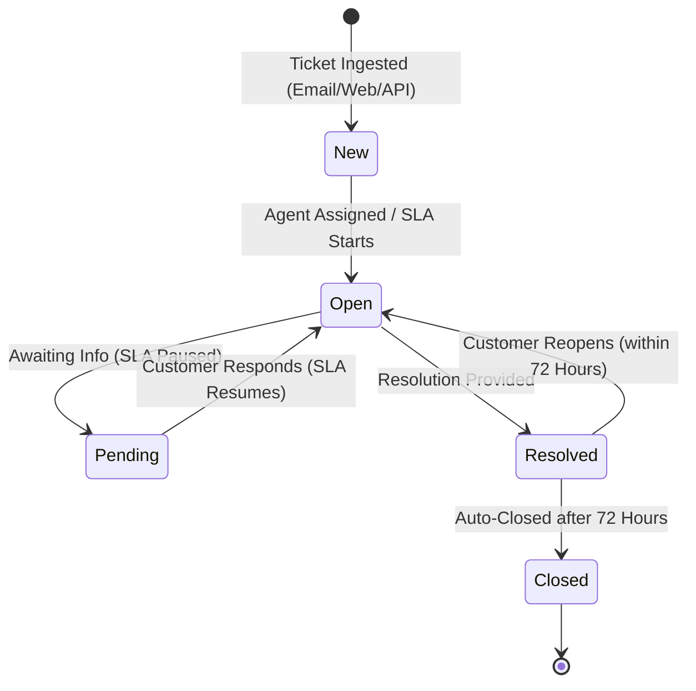
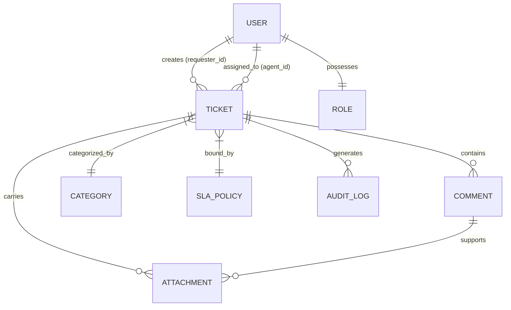
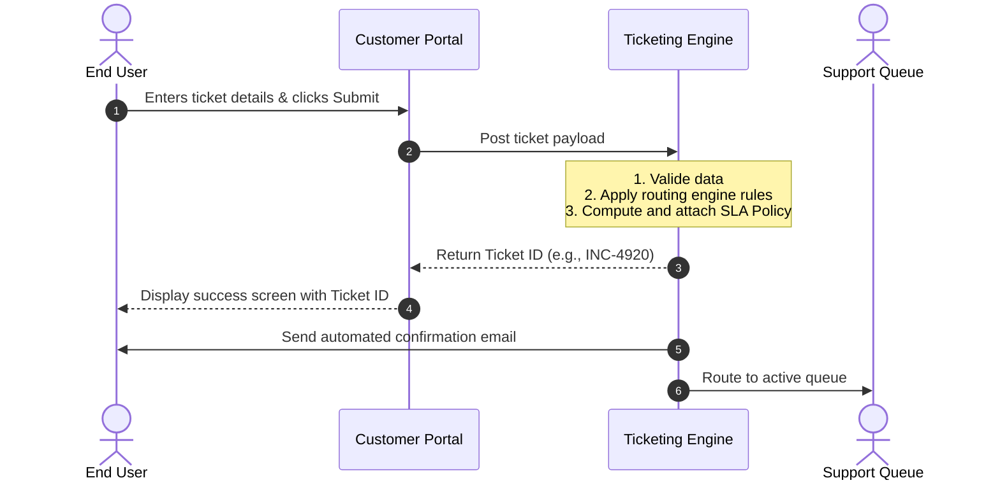

# Software Requirements Specification (SRS)
## Help Desk Ticketing and Reporting System

---

## 1. Document Control & Metadata

| Attribute | Value |
| :--- | :--- |
| **Document Title** | Software Requirements Specification (SRS) - Help Desk Ticketing & Reporting |
| **Target Role** | Implementation Analyst / Configuration Engineer / QA Lead |
| **Version** | 1.0.0 |
| **Status** | Approved |
| **Date** | June 21, 2026 |

---

## 2. Introduction & Executive Summary

### 2.1 Problem Statement
The organization currently handles internal and external support requests via disjointed channels (shared email inboxes, chat channels, and ad-hoc verbal requests). This leads to several operational inefficiencies:
* **Lack of Centralized Tracking:** No single source of truth for support requests, causing tickets to get lost or delayed.
* **Inefficient Routing:** Manual assignment of issues results in bottlenecks, incorrect assignments, and high First Contact Resolution (FCR) times.
* **Zero Service Level Agreement (SLA) Visibility:** Support agents have no real-time visibility into deadline priorities, resulting in breached SLAs and customer dissatisfaction.
* **Absence of Performance Reporting:** Management cannot measure support metrics such as Customer Satisfaction (CSAT), Mean Time to Resolution (MTTR), or team workload distribution.

### 2.2 Objectives
The primary objective of the Help Desk Ticketing and Reporting System is to implement a unified cloud-based SaaS solution to:
1. **Consolidate** all customer support channels into a single ticketing platform.
2. **Automate** ticket routing and escalation using SLA rule engines.
3. **Empower** users with a self-service knowledge base to reduce incoming ticket volume.
4. **Deliver** actionable dashboards and reports on agent efficiency and customer satisfaction metrics.

### 2.3 Scope

#### In-Scope (Included)
* **Omnichannel Ingestion:** Email-to-ticket conversion, customer web portal submissions, and API-based ticket creation.
* **Ticket Management Lifecycle:** Custom statuses, categories, prioritization, routing rules, and internal collaboration tools (private notes).
* **SLA Configuration Engine:** SLA rule definition based on priority, business hours calendars, and escalation chains.
* **Customer Self-Service Portal:** Knowledge base (FAQ/Articles), search indexing, and a personal dashboard to view/reply to tickets.
* **Reporting & Analytics Dashboard:** Pre-configured charts, exportable CSV/PDF reports, and custom scheduler engines.

#### Out-of-Scope (Excluded)
* **IT Asset Management (ITAM):** Tracking of physical hardware, soft licenses, or device configuration databases (CMDB).
* **Project Management Suite:** Full-blown Scrum/Kanban project boards (Jira-style) for product development teams.
* **Payment & Invoicing Gateway:** Billing clients directly inside the help desk for support hours rendered.

### 2.4 Expected Outcomes
* **MTTR Reduction:** Reduce Mean Time to Resolution by **30%** within the first 6 months.
* **Improved CSAT:** Achieve and maintain an average Customer Satisfaction rating of **4.5/5.0**.
* **Self-Service Redirection:** Deflect at least **20%** of Tier-1 support requests through Knowledge Base suggestions.
* **SLA Compliance:** Achieve an overall SLA compliance rate of **95%** or higher.

---

## 3. User Roles & Permissions Matrix

The system enforces Role-Based Access Control (RBAC). The table below outlines the core modules accessible by each user role:

| Module / Feature | End User (Requester) | Tier-1 Support Agent | Tier-2/Tier-3 Agent | Support Manager | System Administrator / Implementation Analyst |
| :--- | :---: | :---: | :---: | :---: | :---: |
| **Browse Knowledge Base** | Read-Only | Read-Only | Read-Only | Read-Only | Read-Only |
| **Create / View Own Tickets** | Full Access | Full Access | Full Access | Full Access | Full Access |
| **Edit / Assign Any Ticket** | No Access | Update/Self-Assign | Full Access | Full Access | Full Access |
| **Publish KB Articles** | No Access | Draft Only | Full Access | Full Access | Full Access |
| **Define SLAs & Business Hours** | No Access | No Access | No Access | Full Access | Full Access |
| **System Configurations & APIs** | No Access | No Access | No Access | Read-Only | Full Access |
| **Generate & View Analytics** | No Access | Own Metrics | Own Metrics | Full Access | Full Access |

---

## 4. System Workflow & Data Architecture

An understanding of the operational lifecycle and basic entity structure is essential for an Implementation Analyst during data mapping and configuration.

### 4.1 Ticket State Machine (Lifecycle)
The diagram below illustrates the allowable transitions of a support ticket from ingestion to resolution.

### 4.2 Entity Relationship Diagram (ERD)
The logical database model configured during implementation:

---

## 5. Functional Requirements

### 5.1 Ticket Ingestion & Management (FR-TKT)

#### FR-TKT-001: Email-to-Ticket Conversion
* **Description:** The system must monitor configured IMAP/POP3 mailboxes (e.g., `support@company.com`) and automatically generate a ticket from incoming emails.
* **Details:**
  * Sender email maps to the `Requester` user account (auto-create user if not found).
  * Email subject maps to `Ticket Title`.
  * Email body maps to the initial `Ticket Description` (rich text/HTML supported).
  * Inline attachments and email attachments must be linked to the ticket object.

#### FR-TKT-002: Manual Routing & Auto-Assignment
* **Description:** Support managers or agents must be able to manually assign tickets to specific agents or groups.
* **Details:** The system must support automatic assignment protocols:
  * **Round-Robin:** Distributed equally among online agents within a department.
  * **Load Balancing:** Assigned to the agent with the lowest number of active `Open` tickets.

#### FR-TKT-003: Agent Collaboration (Private Notes)
* **Description:** Agents must be able to write internal notes within a ticket that are hidden from the End User.
* **Details:** Private notes must be visually distinct (e.g., highlighted in light yellow) and exclude notifications to the requester.

### 5.2 Customer Portal & Knowledge Base (FR-KB)

#### FR-KB-001: Self-Service Ticket Submission
* **Description:** End Users must have a clean, authenticated web interface to submit tickets.
* **Details:** Required fields: *Category, Priority (Impacted Users), Subject, and Description*. Dynamic ticket fields should render based on the chosen category.

#### FR-KB-002: Smart Knowledge Base Suggestion
* **Description:** When an End User types a ticket subject in the portal, the system must search the Knowledge Base and display recommended articles before submission.
* **Details:** If the user clicks "This resolved my issue," the ticket creation flow is canceled, incrementing the article's "Helpfulness Score."

### 5.3 SLA Management Engine (FR-SLA)

#### FR-SLA-001: Multi-Tiered SLA Definition
* **Description:** The system must evaluate ticket fields to apply SLA policies defining response and resolution targets.
* **Details:** SLAs must support priority levels (Urgent, High, Medium, Low) mapped to elapsed business hours:
  * **Urgent:** Respond in 1 hour; Resolve in 4 hours.
  * **High:** Respond in 4 hours; Resolve in 8 hours.
  * **Medium:** Respond in 8 hours; Resolve in 24 hours.
  * **Low:** Respond in 24 hours; Resolve in 72 hours.

#### FR-SLA-002: SLA Pause Rules
* **Description:** The SLA countdown timer must pause when a ticket status changes to `Pending` (awaiting information from customer) and resume when changed back to `Open`.

### 5.4 Reporting & Analytics (FR-RPT)

#### FR-RPT-001: Real-Time Performance Dashboard
* **Description:** Managers must have access to a dashboard tracking core performance key performance indicators (KPIs).
* **Details:** KPIs include: *Open tickets, Breach status, Average Response Time (ART), MTTR, and CSAT*.

#### FR-RPT-002: SLA Breach Alerts
* **Description:** The system must trigger email alerts and push notifications to agents and supervisors at configured thresholds:
  * **SLA Warning:** Triggered at **75%** of target duration elapsed.
  * **SLA Breached:** Triggered immediately when target duration is breached.

---

## 6. Non-Functional Requirements

### 6.1 Performance & Scalability (NFR-PERF)
* **NFR-PERF-001:** Search queries across a database of up to 1,000,000 tickets must return results in under **1.5 seconds**.
* **NFR-PERF-002:** The system must support up to **500 concurrent agents** and **10,000 concurrent portal users** without degrading response times below 2 seconds API response time.

### 6.2 Security & Compliance (NFR-SEC)
* **NFR-SEC-001 (Encryption):** All data must be encrypted in transit using **TLS 1.3** and at rest using **AES-256**.
* **NFR-SEC-002 (Compliance):** The system must provide data deletion mechanisms to satisfy **GDPR "Right to be Forgotten"** requests.
* **NFR-SEC-003 (SSO Integration):** The authentication module must support Single Sign-On (SSO) via **SAML 2.0** and **OpenID Connect (OIDC)**.

### 6.3 Reliability & Availability (NFR-REL)
* **NFR-REL-001:** The system uptime must meet or exceed **99.9% availability** (excluding scheduled monthly maintenance windows of max 2 hours, occurring on weekends).
* **NFR-REL-002:** Maximum allowable Data Loss (RPO - Recovery Point Objective) must be under **15 minutes**, enabled by transaction log shipping.

---

## 7. Use Cases

### 7.1 Use Case 1: Submitting and Ingesting a Ticket
* **Use Case ID:** UC-TKT-001
* **Primary Actor:** End User (Requester)
* **Preconditions:** End User is registered and authenticated on the Customer Portal.
* **Postconditions:** Ticket is logged in the database, SLA is assigned, and a confirmation email with a ticket ID is sent to the End User.

#### Main Flow:
1. End User logs into the customer portal.
2. End User clicks on "Submit a Ticket".
3. End User selects Category (e.g., "Network/VPN Access"), inputs a description, attaches a screenshot, and submits.
4. System validates the request fields.
5. System scans the configuration metadata, matches priority criteria, and attaches the SLA target timestamp.
6. System routes the ticket to the "Network Operations" queue.
7. System generates an email notification containing the ticket ID and links to check progress.

---

### 7.2 Use Case 2: SLA Breach Escalation
* **Use Case ID:** UC-SLA-002
* **Primary Actor:** System Scheduler Daemon
* **Preconditions:** Active ticket with `Open` status has breached its designated resolution time.
* **Postconditions:** Ticket priority is reassessed, ticket is escalated, and notifications are sent to managers.

#### Main Flow:
1. The background scheduler checks ticket timestamps every 5 minutes.
2. System identifies an active open ticket (`INC-1002`) where current time exceeds the `SLA_Resolution_Deadline`.
3. System changes the Ticket Severity status to `Breached`.
4. System posts a system audit log record tracking the event.
5. System triggers a webhook / email alert notification containing SLA breach metrics to the Help Desk Supervisor.
6. System reassigns the ticket to the Tier-2 Queue.

---

## 8. Implementation Analyst Configuration Matrix

> [!IMPORTANT]
> The table below outlines configuration variables that the Implementation Analyst must define in the environment configurations or system admin dashboard during tenant provisioning.

| Config Parameter | Data Type | Default Value | Description |
| :--- | :--- | :--- | :--- |
| `INBOUND_EMAIL_IMAP` | String | `imap.company.com` | Inbound IMAP address for support ticket email creation. |
| `SLA_PAUSE_STATUSES` | Array | `["Pending", "On-Hold"]` | List of ticket statuses that pause the SLA count. |
| `AUTO_CLOSE_TIMEOUT_HRS`| Integer | `72` | Number of hours a ticket remains resolved before auto-closing. |
| `MAX_FILE_SIZE_MB` | Integer | `15` | Maximum size constraint for single ticket attachment. |
| `ALLOWED_EXTENSIONS` | Array | `["pdf", "png", "jpg", "docx"]` | File extension whitelist for file attachment security. |
| `SSO_METADATA_URL` | String | `https://sso.okta.com/idp/...` | SAML IdP metadata provider link for Single Sign-On. |
