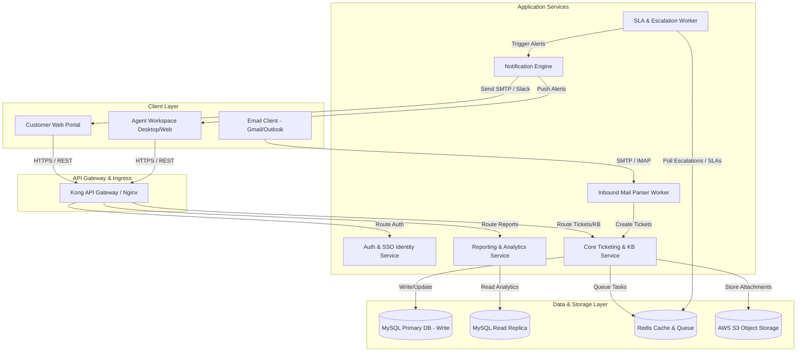
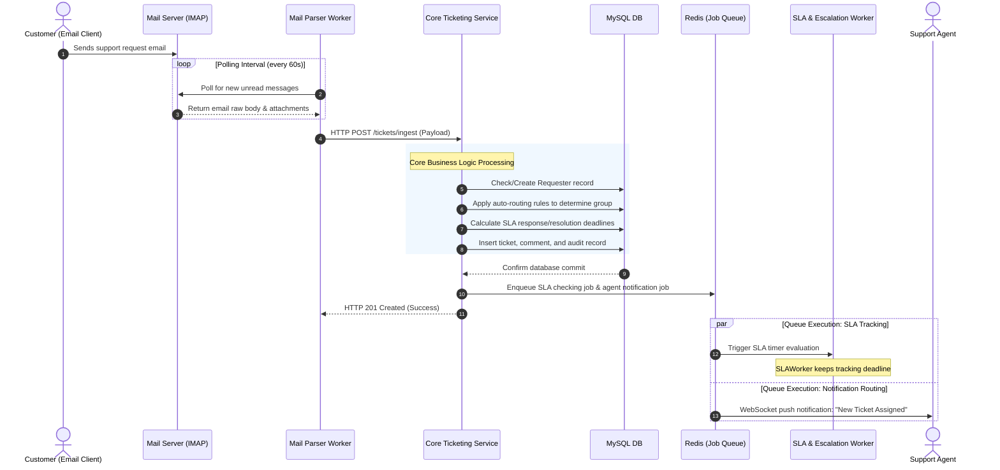

# System Architecture Specification
## Help Desk Ticketing and Reporting System

This document outlines the high-level system architecture, component layout, data flow patterns, module breakdowns, and the recommended technology stack for the Help Desk Ticketing and Reporting System.

---

## 1. High-Level System Architecture Diagram

The system follows a containerized micro-services / modular monolith pattern. It isolates transactional ticket operations, analytics read operations, and asynchronous background jobs.



---

## 2. Component Descriptions

### 2.1 Frontend Components
The frontend is split into two specialized single-page web applications (SPAs) optimized for performance and accessibility.

1. **Customer Self-Service Portal (SPA)**
   * **Purpose:** Interfaces with end-users for creating, tracking, and replying to tickets.
   * **Key Components:**
     * *Knowledge Base (KB) Browser:* Features real-time search indexing and article rating.
     * *Ticket Submission Wizard:* Custom forms with validation and file drop-zones.
     * *Customer Ticket View:* Thread-based list displaying public messages and state indicators.
2. **Agent Workspace & Management Console (SPA)**
   * **Purpose:** Single-pane dashboard UI for support agents and administrators.
   * **Key Components:**
     * *Live Queue Console:* Grid layout displaying assigned queues with live SLA timers.
     * *Rich Editor Workspace:* Includes canned replies, Markdown support, and private notes.
     * *Real-Time Supervisor Analytics:* Charting dashboard showing agent capacity and SLA breach warnings.
3. **Shared UI Architecture Modules**
   * *State Management:* Handles local ticket state, workspace filters, and cached session metadata.
   * *WebSocket Client:* Connects to the gateway to receive real-time notifications of ticket updates.

### 2.2 Backend Components
The backend relies on isolated, stateless services capable of horizontal scaling.

1. **API Gateway**
   * Handles incoming client requests, manages SSL termination, checks rate-limits (e.g., max 100 requests/minute per client), and routes traffic to downstream services.
2. **Auth & Identity Service**
   * Acts as the Identity Provider (IdP). Generates short-lived JSON Web Tokens (JWT) for authentication. Implements OAuth2/SAML middleware to enable external SSO sync (e.g., Okta, Azure AD).
3. **Core Ticketing Service**
   * Houses the business logic of ticket routing, category matching, and ticket creation. Orchestrates database write transactions.
4. **Reporting & Analytics Engine**
   * Handles read-heavy reporting queries. Connects to database read-replicas to prevent resource starvation on the primary transactional database during large report compilations.
5. **Asynchronous Background Workers**
   * *SLA & Escalation Worker:* Evaluates ticket thresholds, alerts teams on upcoming breaches, and updates escalation states.
   * *Mail Parser Worker:* Polling agent connecting to IMAP folders to ingest support emails.
   * *Notification Engine:* Decoupled SMTP/Webhook publisher that manages email relays and Slack/Teams integrations.

### 2.3 Database & Storage Components
1. **Primary Relational Database (MySQL 8.0+)**
   * Stores structured operational data: ticket properties, user definitions, SLA settings, and audit logs.
2. **Read Replica Database**
   * A read-only clone of the primary database. Offloads reporting queries, analytics, and metrics aggregation.
3. **Memory Cache & Queue (Redis)**
   * Acts as the session state store, API rate-limit counter, and message broker for background job distributions (e.g., queueing emails and SLA calculation tasks).
4. **Cloud Object Storage (AWS S3 or MinIO)**
   * Provides storage for file uploads (PDFs, screenshots, logs) linked to tickets and comments.

---

## 3. Core Modules Breakdown

```
├── Authentication Module
│   ├── Login / Logout (JWT validation)
│   └── SSO / SAML Handlers
├── Ticket Engine Module
│   ├── Intake Controller (Email, API, Web)
│   ├── Routing Controller (Round-Robin, Load-Balancer)
│   └── State transition state machine
├── Collaboration Module
│   ├── Rich-Text Commenting
│   └── Internal Private Threading
├── SLA Engine Module
│   ├── SLA Rule Evaluator
│   ├── Business Calendar Resolver
│   └── SLA Action Escalator
├── Knowledge Base Module
│   ├── Search Auto-suggest
│   └── Article Publishing Lifecycle
└── Reporting & Auditing Module
    ├── Dashboard Aggregation (ART, MTTR, CSAT)
    └── Audit Log Writer
```

---

## 4. End-to-End Data Flow

The sequence diagram below shows the flow of data when a **Customer Ticket is Ingested via Inbound Email, routed, evaluated for SLA, and notified to an agent**.



---

## 5. Technology Stack Recommendations

| Component Layer | Technology Option (Recommended) | Rationale |
| :--- | :--- | :--- |
| **Frontend Framework** | **React 18+** / **TypeScript** / **Vite** | Single-page framework with an active ecosystem. TypeScript ensures compile-time safety for ticket interfaces. |
| **UI Styling** | **Tailwind CSS** & **Radix UI** | Modern CSS utility layer coupled with accessible headless components, yielding professional, customized workspaces. |
| **Backend Core** | **Node.js** with **NestJS** | Highly modular, scalable backend framework. Offers excellent integration with SQL database ORMs and job managers. |
| **Background Jobs** | **BullMQ** (powered by Redis) | High-performance, low-overhead distributed task framework in Node.js. Handles retries, delays, and scheduling. |
| **Primary Database** | **MySQL 8.0** | Relational capabilities with strong support for transactions (`InnoDB`), complex joins for reporting, and spatial indexes. |
| **Caching & Messaging** | **Redis 7.0** | In-memory key-value cache. Ideal for session management, API rate limiting, and backpressure messaging. |
| **File Storage** | **AWS S3** or **MinIO** | Standard API for secure, scalable file storage. MinIO serves as a local development drop-in. |
| **Infrastructure / DevOps**| **Docker** / **Kubernetes** / **Terraform**| Ensures predictable setups across local developer machines, staging servers, and elastic cloud environments. |
